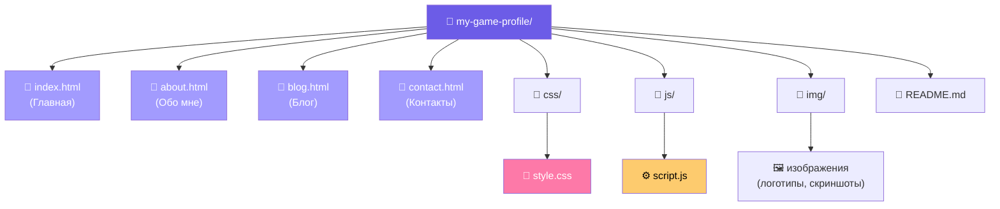

# It's GameProfile — сайт-визитка игрового профиля

## Описание

Статический сайт-визитка, посвящённый игровому профилю в разных сервисах (Steam, PlayStation, Xbox, Nintendo). Сделан на чистом HTML, CSS и JavaScript в рамках учебного задания.

## Функциональность

- Адаптивный дизайн (Mobile First)
- Тёмная и светлая тема с сохранением в localStorage
- Сохранение имени игрока из формы контактов в localStorage
- Плавные анимации появления при скролле
- Анимированные счётчики статистики
- Навигация между 4 страницами

## Структура проекта

my-web-site/

├── index.html

├── about.html

├── contact.html

├── blog.html

├── css/style.css

├── js/script.js

├── img/

└── README.md

# GameProfile — сайт-визитка игрового профиля

## Описание
Статический сайт-визитка, посвящённый игровому профилю в разных сервисах (Steam, PlayStation, Xbox, Nintendo). Сделан на чистом HTML, CSS и JavaScript в рамках учебного задания.

---

## 🗺️ Структура проекта

## архитектура Javascript

```mermaid
graph TB
    Script["⚙️ script.js"]

    Script --> Theme["🌗 Модуль темы"]
    Script --> Form["📩 Модуль формы"]
    Script --> ScrollAnim["✨ Анимация скролла"]
    Script --> Counters["🔢 Анимированные счётчики"]

    Theme --> T1["localStorage.getItem('theme')<br/>при загрузке"]
    Theme --> T2["Клик по #theme-toggle"]
    Theme --> T3["body.classList.toggle('dark')"]
    Theme --> T4["localStorage.setItem('theme', ...)"]

    Form --> F1["Восстановление имени из<br/>localStorage.getItem('playerName')"]
    Form --> F2["Submit формы"]
    Form --> F3["localStorage.setItem('playerName', name)"]
    Form --> F4["Показ сообщения об успехе"]

    ScrollAnim --> S1["querySelectorAll('.animate-on-scroll')"]
    ScrollAnim --> S2["getBoundingClientRect().top"]
    ScrollAnim --> S3["classList.add('visible')"]

    Counters --> C1["IntersectionObserver<br/>threshold: 0.5"]
    Counters --> C2["setInterval + increment"]
    Counters --> C3["Обновление textContent"]

    style Script fill:#6c5ce7,color:#fff
    style Theme fill:#a29bfe,color:#fff
    style Form fill:#a29bfe,color:#fff
    style ScrollAnim fill:#a29bfe,color:#fff
    style Counters fill:#a29bfe,color:#fff
```

## Лицензия
Проект создан с учётом лицензии [MIT]()

---

### 💡 Что показывают диаграммы

| Диаграмма | Тип Mermaid | Что иллюстрирует |
|---|---|---|
| Структура проекта | `graph TD` | Файловая иерархия |
| Навигационная карта | `flowchart LR` | Связи между страницами |
| Архитектура JS | `graph TB` | Модули `script.js` |
| Поток темы | `sequenceDiagram` | Взаимодействие с `localStorage` |
| Поток формы | `sequenceDiagram` | Обработка `submit` |
| Анимации скролла | `flowchart TD` | `IntersectionObserver` |
| Счётчики | `sequenceDiagram` | Таймер и `IntersectionObserver` |
| Адаптивность | `graph LR` | Breakpoints |
| CSS-переменные | `graph TD` | Слои тем |
| Деплой | `flowchart LR` | Шаги GitHub Pages |

Все диаграммы отрисуются автоматически на GitHub при просмотре `README.md` — специальных плагинов не требуется. 🎉